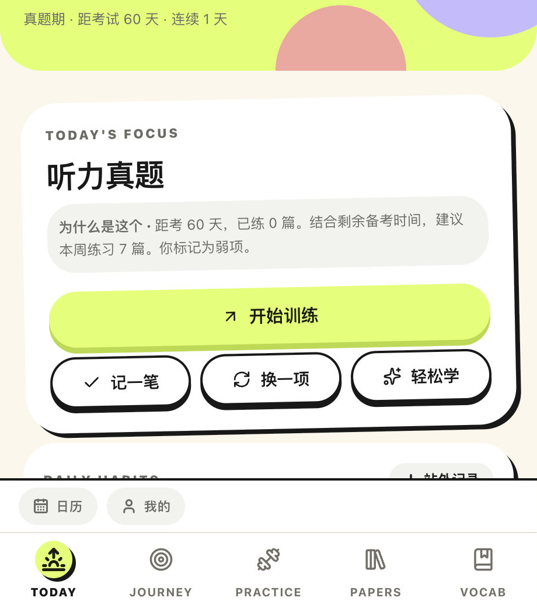
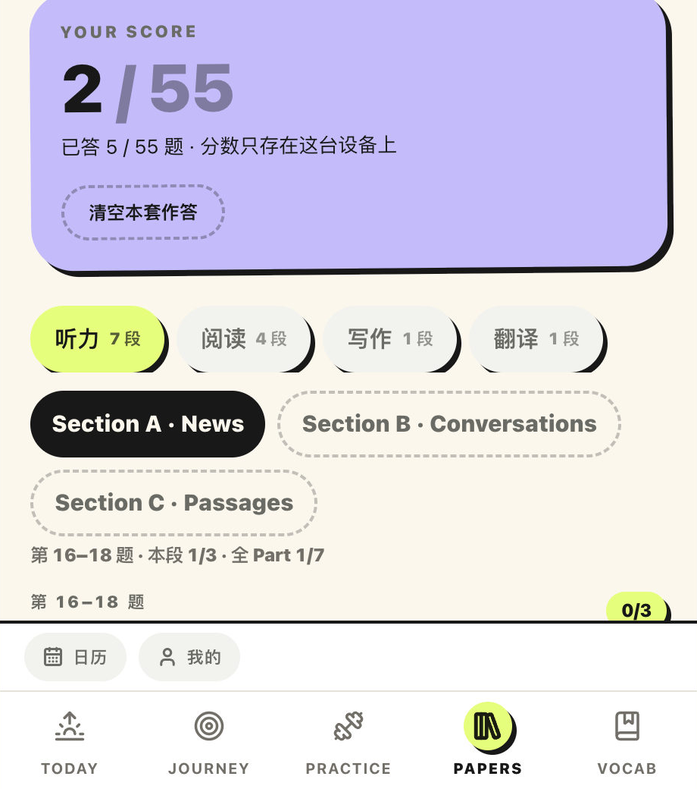
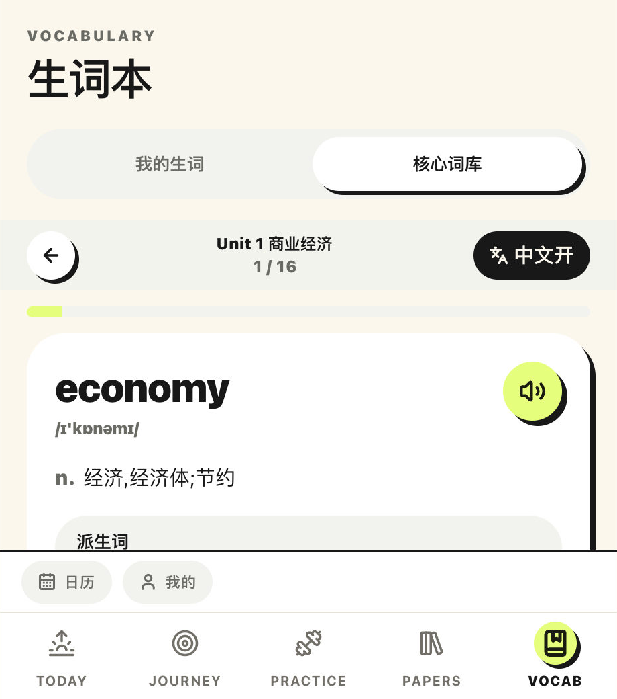
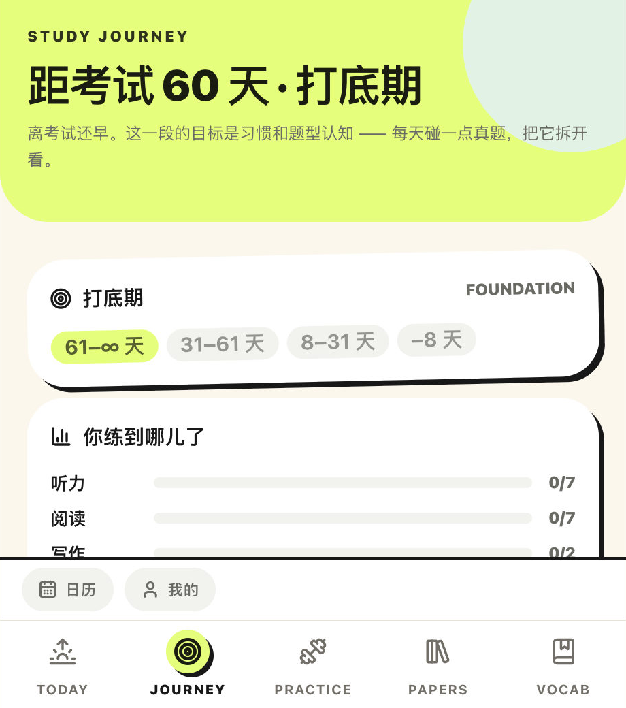
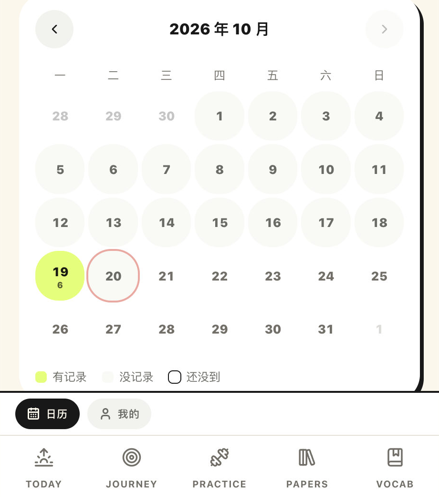

<div align="center">

# CET-6 Study Companion

### Less planning. More learning.

一个为中国大学生打造的六级备考工具。

不用制定复杂的学习计划。打开、练习、记录，按照自己的节奏准备六级。

真题练习 · 词汇积累 · 学习建议 · 进度记录

功能介绍 · 快速开始 · 技术栈 · 开发进度

</div>

---

## ✨ Why I Built This

准备六级的时候，我们往往不缺学习资料。

真题、单词书、精听教程到处都有。但真正开始学时，还是经常遇到这些问题：

- 今天到底练什么？
- 做完真题，错题和生词怎么整理？
- 学习了几天，怎么知道自己有没有进步？
- 中间断了几天，是不是又得重新制订计划？

我想做一个尽量简单的工具，把这些事情串起来。

CET-6 Study Companion 不是一个要求你每天完成固定任务的打卡 App，也不打算再造一个庞大的题库。

它更像一个随时可以打开的学习工作台：给你一点建议，提供真正能用的练习工具，帮你把学过的东西留下来。

没有必须兑现的学习时长，也没有做不完就不断累积的任务。

You set the goal. You make the progress.

---

## 🚀 Features

### 🧭 Study Journey

有学习建议，但不替你安排生活。

根据距离考试的时间、已有练习记录和你自己标记的薄弱项，推荐下一步值得练习的内容。

- 根据考试日期切换备考阶段
- 首页只推荐一项 Today's Focus
- 支持更换建议或选择轻量练习
- 每周提供学习目标参考，可以接受、调整或忽略
- 不强制填写每周学习时间
- 没完成的建议不会无限积压

推荐依据公开可见。没有足够的数据，就不假装了解你的水平。

### 📝 Real CET-6 Papers

按真实考试的方式做真题。

目前已收录 2025 年 12 月六级第一套真题，包含听力、阅读、写作、翻译及对应解析材料。

- 听力、阅读、写作、翻译四大板块
- 按考试规定时长计时
- 听力只显示选项，不提前显示题干
- 交卷后解锁答案、解析与参考材料
- 阅读原文支持点击记生词
- 选词填空支持直接在文章空格中填词
- 可以自主标记备选词词性，交卷后对照分析
- 作答进度与草稿保存在本地

听力播放器支持拖动进度和倍速播放。

目前使用经过核对的篇章级音频分段；逐句精听仍在开发中。

### 📚 Vocabulary

词库是词库，生词是生词。

目前提供两个相互关联、但用途不同的区域。

**核心词库**

基于已有的六级核心词汇资料整理：

- 按单元和专题浏览
- 一屏一词，支持左右滑动翻卡
- 英音 / 美音切换
- 中文释义显示与隐藏
- 派生词、近义词、反义词与常用词组
- 真题例句及原有重点标注
- 同义替换专题学习

**我的生词**

只留下你真正想记的词：

- 阅读原文中点击单词即可收藏
- 手动添加释义和备注
- 搜索、编辑、删除
- 翻卡复习
- 保留生词来源，方便回到原题

同一个词重复收藏不会产生多份记录，也不会覆盖你自己写过的释义。

> 当前的生词复习还是基础翻卡模式，尚未接入完整的间隔重复算法。

### 📅 Learning History

记录学过什么，而不是追究哪天没学。

真题、词汇、自主练习和站外学习都可以进入同一份学习记录。

- 日历查看每天的学习情况
- 点击日期回顾具体内容
- 记录站外学习
- 查看近期练习情况
- 生成每周学习回顾
- 不设置强制学习日
- 不因某天没有记录就制造“欠账”

空白的日子只是空白，不意味着失败。

### 🎯 Practice

不想跟着推荐走？可以直接选择自己想练的内容。

Practice 页面提供不同训练方向的入口，包括听力、阅读、词汇、写作、翻译等。

自主完成的学习同样可以记录，不需要先加入某个计划。

长难句专项训练、错题复盘等独立练习页面还在开发中。

---

## 📱 Preview

以下均为实际运行的产品界面。

| Today's Focus | CET-6 Papers | Vocabulary |
|:---:|:---:|:---:|
|  |  |  |
| 今日推荐 | 真题练习 | 核心词库 |

| Study Journey | Learning History |
|:---:|:---:|
|  |  |
| 备考路径 | 学习日历 |

---

## ⚡ Quick Start

需要 Node.js 24 环境及 npm。

项目内附带工作区本地 Node 工具链（.toolchain/node24），如果该目录存在，可以直接使用，无需额外安装全局 Node。

```bash
# 使用项目内置 Node（如存在）
export PATH="$PWD/.toolchain/node24/bin:$PATH"

# 安装依赖
npm install

# 启动开发服务器
npm run dev
```

打开：

http://localhost:3000

生产环境构建：

```bash
npm run build
npm start
```

运行完整检查：

```bash
npm run check
```

更多验证命令：

```bash
# 完整验证
npm run verify

# 真题数据完整性检查
npm run verify:papers

# 生词本数据写入验证
npm run verify:vocab

# Study Journey 数据与行为验证
npm run verify:plan
```

项目包含针对学习记录、数据持久化、真题答案、音频分段和词汇数据的自动化校验。

---

## 🛠 Tech Stack

| Category | Technology |
|---|---|
| Framework | Next.js 16 (App Router) |
| UI | React 19 |
| Language | TypeScript |
| Styling | Tailwind CSS v4 |
| Local Database | Dexie / IndexedDB |
| Icons | Lucide React |
| Animation | Motion |
| Speech | Web Speech API |
| Testing & Verification | TypeScript, ESLint, custom verification scripts |

采用 local-first 架构。

目前不需要注册账号，也不依赖云端数据库来保存学习进度。

### Privacy by Default

你的学习记录保存在当前设备的浏览器存储中。

- 无需登录
- 学习记录默认不上传服务器
- 支持 JSON 备份导出与恢复
- 无跨设备自动同步

需要注意：

清除浏览器网站数据可能导致本地学习记录丢失。

建议定期导出备份。

此外，本地优先不代表网页本身完全离线。首次加载应用及部分资源仍可能需要网络。

---

## 🧩 How It Works

项目的核心思路是：

```text
Set your goal
       ↓
Get a suggestion
       ↓
Choose what to practice
       ↓
Practice & save progress
       ↓
Review your learning history
       ↓
Keep going
```

### One learning record, multiple entry points

不管你从哪里开始学习：

- Today's Focus
- Study Journey
- Practice
- Vocabulary
- Papers
- 站外学习记录

最终都应该汇入统一的学习记录。

这样可以避免自主练习和推荐任务重复计数，也让日历和周报基于实际发生的学习行为生成。

### Recommendations, not obligations

系统推荐主要依据：

1. 距离考试的天数
2. 已有真题练习覆盖情况
3. 用户自己标记的薄弱项

不通过四级成绩推算六级分数，也不根据几道练习题预测最终成绩。

所有推荐都可以被修改或忽略。

---

## 📂 Project Structure

```text
src/
├── app/
│   ├── today/          # Today's Focus
│   ├── plan/           # Study Journey
│   ├── practice/       # Practice
│   ├── papers/         # CET-6 Papers
│   ├── vocab/          # Vocabulary
│   ├── calendar/       # Learning History
│   └── me/             # Profile & Settings
├── components/
│   ├── ui/             # Shared UI components
│   ├── paper/          # Exam interface
│   ├── vocab/          # Wordbook & flashcards
│   └── mood/           # Contextual copy
└── lib/
    ├── db.ts           # IndexedDB schema
    ├── repo.ts         # Data operations
    ├── journey.ts      # Recommendation engine
    ├── stats.ts        # Learning statistics
    ├── vocab.ts        # Vocabulary logic
    ├── wordbooks.ts    # Wordbook data access
    └── papers/         # Paper data & exam logic

scripts/
├── verify.ts
├── verify-papers.ts
├── verify-vocab-store.ts
├── verify-plan-store.ts
├── parse-wordbooks.py
└── extract-highlights.py

public/
└── audio/
```

---

## 🗺 Roadmap

这是一个持续开发中的个人项目。

### ✅ Available

- [x] 入学档案与目标考试场次
- [x] Study Journey 学习建议
- [x] Today's Focus 今日推荐
- [x] 自定义每周学习目标
- [x] 2025 年 12 月六级真题第一套
- [x] 真题考场计时与交卷后解析
- [x] 听力播放、倍速与进度拖动
- [x] 选词填空交互作答与词性标记
- [x] 核心词库与同义替换专题
- [x] 单词翻卡与本机发音
- [x] 阅读原文点击收藏生词
- [x] 生词本与基础复习
- [x] 学习记录与日历
- [x] IndexedDB 本地持久化
- [x] JSON 数据备份

### 🚧 In Progress / Planned

- [ ] Sentence Lab：交互式长难句拆解
- [ ] 精听训练：盲听、逐句精听、跟读与复盘
- [ ] 听力逐句时间戳对齐
- [ ] 逐题重听：单独播放某一道题的题干
- [ ] 单词间隔重复算法
- [ ] 生词自动释义
- [ ] 核心词库例句同义替换练习界面
- [ ] 独立错题复盘模块
- [ ] 历史日期学习补录
- [ ] 学习提醒与通知

接下来会优先完善学习内容本身，特别是精听与长难句训练体验。

---

## 🤝 Contributing

欢迎提出建议、反馈问题，或一起改进学习体验。

如果你发现：

- 真题内容或解析存在错误
- 某个页面在手机上无法正常使用
- 学习记录没有正确保存
- 交互流程不够顺畅
- 有值得加入的训练方法

欢迎提交 Issue。

提交 Bug 时，最好附上复现步骤、浏览器版本和必要的截图。

如果希望提交代码，可以先通过 Issue 讨论较大的改动，避免重复开发。

---

## 📌 Notes

这个项目仍在迭代中，部分训练模块尚未完成。

CET-6 Study Companion 是独立学习工具，不是官方大学英语六级考试平台。

六级真题、音频、解析及第三方词汇资料的相关权利归其各自权利人所有。公开部署或再分发相关内容前，应确认具有适当授权。

设计取舍与逐轮开发记录见 [docs/DESIGN-NOTES.md](docs/DESIGN-NOTES.md)。

---

## 📄 License

源代码采用 [MIT](LICENSE) 许可（Copyright © 2026 flagos）。

真题、音频、解析与第三方词汇资料不在此许可范围内，相关权利归各自权利人所有。

---

<div align="center">

Less planning. More learning.

Made for students who just want to get started.

</div>
